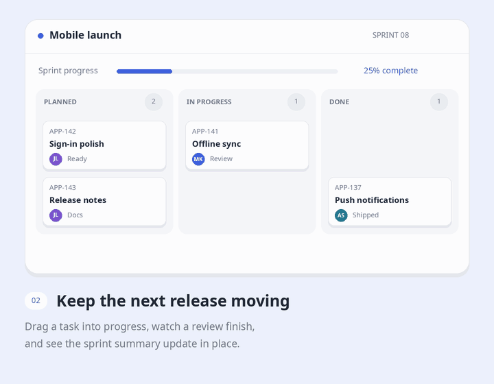

# Animated Feature Cards

A coding-agent skill for building small, looping product demos inside feature cards. Show a task moving across a board, a search returning an answer, or a forecast becoming an action—all within a compact piece of UI.

The skill helps an agent choose a scene, write its storyboard, and implement it using your project's framework and design system. It covers pacing, cursor movement, staged responses, quiet resets, reduced motion, and responsive layouts.

## Examples

Four original examples with fictional data. Each animation runs for 12 seconds, holds its result, and crossfades back to the beginning. The GIFs illustrate the kind of work the skill guides; they are documentation assets, not components you install in your app.

Prefer still images? [View all four static previews](assets/examples/README.md). GIF playback depends on your Markdown viewer and does not automatically honor reduced-motion preferences.

### 1. Workspace assistant


A miniature conversation makes the assistant's work visible. The question appears first, a search tool shows its status, and the answer arrives with two concrete blockers and links to the underlying notes.

| Beat | What changes |
| --- | --- |
| Establish | A connected workspace and research context are already visible. |
| Ask | “What is blocking the mobile launch?” appears in a user bubble. |
| Search | A `search_workspace` row shows activity, then resolves to “3 sources found.” |
| Answer | Two launch blockers appear, followed by source chips. |
| Rest | The answer stays readable before the conversation resets. |

**Useful for:** knowledge search, research assistants, support copilots, and tool-connected chat. Adapt the question, tool status, and evidence to the product. Keep the answer short enough to read during the final pause.

### 2. Sprint board



A three-column board tells two related stories: a teammate starts a task, then an existing review finishes. Task identifiers, assignee avatars, column counts, and an activity summary give the movement context.

| Beat | What changes |
| --- | --- |
| Establish | Four tasks sit across Planned, In progress, and Done. |
| Start | A cursor approaches “Sign-in polish” and drags it into progress. |
| Complete | “Offline sync” moves from review to Done. |
| Update | Completion advances from 25% to 50%; the column counts change. |
| Rest | An activity note records the completed task before the reset. |

**Useful for:** project management, approval queues, publishing workflows, and release planning. Preserve each item's identity as it moves. Leave enough space at its destination so cards never overlap.

### 3. Support triage


The inbox stays visible while the selected conversation gains useful structure. Topic and priority labels appear, a routing rule assigns a teammate, and a reply draft becomes ready for review.

| Beat | What changes |
| --- | --- |
| Establish | Three conversations and the selected customer's message are visible. |
| Classify | The selected ticket receives Exports and High priority labels. |
| Route | The assignment row shows the responsible teammate and routing rule. |
| Prepare | “Reply draft ready” appears with an explicit review step. |
| Rest | The complete triage state holds before returning to the initial inbox. |

**Useful for:** shared inboxes, issue routing, document classification, and operations queues. Use state labels alongside color so the result is understandable in a still frame. Show the actual approval boundary for the product being demonstrated.

### 4. Inventory forecast


A chart connects a business signal to a concrete next step. Current stock, daily demand, and remaining cover provide context; the projection then reveals a shortage and a suggested reorder.

| Beat | What changes |
| --- | --- |
| Establish | Stock, order rate, cover, and a reorder threshold are visible. |
| Project | The stock line draws across the coming days. |
| Flag | A warning identifies the projected stockout date. |
| Act | A suggested quantity and supplier lead time appear beside a review action. |
| Rest | The chart and recommendation hold together before resetting. |

**Useful for:** inventory planning, spending forecasts, capacity monitoring, and usage limits. Give charts units and a meaningful threshold. Reveal the suggested action only after the signal that explains it.

## Use the skill

Give your coding agent [SKILL.md](SKILL.md) and keep [references/pattern-catalog.md](references/pattern-catalog.md) beside it. If your agent supports installed skills, place this repository's contents in a skill directory named `animated-feature-cards` using that agent's normal installation process. Skill discovery and invocation vary by agent.

You can also point an agent directly at the instructions:

> Read `SKILL.md` and use its pattern catalog to build four animated feature cards for our landing page. The features are workspace search, task tracking, support routing, and stock forecasting. Inspect the existing components and styling first. Use realistic fictional data, give each card a different motion pattern, and keep the result visible long enough to read. Implement responsive layouts, useful reduced-motion states, and clean up any timers or observers.

For a more specific scene:

> Build a deployment card with a miniature terminal. Show a command being entered, three checks completing, and a deployment URL appearing. Hold the success state, then fade back to the prompt. Match our existing colors and typography. Use our current dependencies and keep the card's outer size stable throughout the loop.

Helpful inputs are the feature's name, the action and result it should show, the target page or component, and any design or motion constraints. If you only have feature copy, the skill asks the agent to invent a suitable storyboard.

## What the skill covers

The [pattern catalog](references/pattern-catalog.md) includes streaming lists, terminal sequences, cursor interactions, connection handshakes, integration states, chat and tool calls, event stacks, filtering, progress rings, maps, counters, and hover-led scenes.

Each card follows a short sequence:

```text
Establish → Action → Response → Result → Dwell → Reset
```

Scenes should use believable miniature interfaces: clear labels, useful status changes, and one main action at a time. Combine different patterns within a section so every card does not repeat the same cursor or typing effect.

## Motion and implementation

These are starting points for live implementations; adapt them to the amount of information a viewer needs to read.

| Element | Starting range |
| --- | --- |
| Small state transition | 180–350 ms |
| Row or card movement | 300–600 ms |
| Cursor travel | 500–1,000 ms |
| Final result hold | 1.2–2.5 seconds, longer for detailed content |
| Complete loop | 7–16 seconds |

Keep the outer card stable and clip motion inside its demo area. Favor transforms and opacity, deterministic data, and explicit scene states. Reuse the application's components, tokens, icons, and installed animation tools; simple scenes often need only CSS and a small state machine.

For shipped interfaces, provide a meaningful static state under reduced motion, preserve real hover and keyboard behavior, and clean up timers and observers when the component unmounts. Pause offscreen work where appropriate. Check narrow layouts, text clipping, and the loop boundary as carefully as the main action. These GIFs cannot demonstrate those runtime behaviors.

## Repository contents

| Path | Purpose |
| --- | --- |
| [SKILL.md](SKILL.md) | Main agent instructions and quality checklist |
| [references/pattern-catalog.md](references/pattern-catalog.md) | Storyboards and implementation notes for 12 patterns |
| [agents/openai.yaml](agents/openai.yaml) | Agent-facing display metadata |
| [assets/examples/](assets/examples/) | Four animated GIFs and matching static PNGs |
| [scripts/render_examples.py](scripts/render_examples.py) | Reproducible source for the README illustrations |

## Regenerate the illustrations

The illustration renderer uses Python with Pillow and the Noto Sans regular and bold font files. It draws the scenes locally with fictional data; no API keys, network services, or image-generation service are required.

From the repository root, in an environment with Pillow installed:

```sh
python scripts/render_examples.py
```

By default it reads `NotoSans-Regular.ttf` and `NotoSans-Bold.ttf` from `/usr/share/fonts/noto`. Set `EXAMPLE_FONT_DIR` to a directory containing those files if they live elsewhere.

The script regenerates all four GIF/PNG pairs in `assets/examples/`. Each GIF is 720 × 560, loops indefinitely, and uses a shared palette across its frames to keep colors stable. The PNGs show the completed scenes. This renderer is only for documentation; implement website cards with the host application's UI stack.
