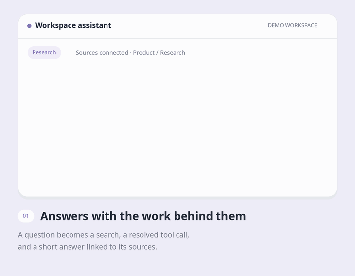
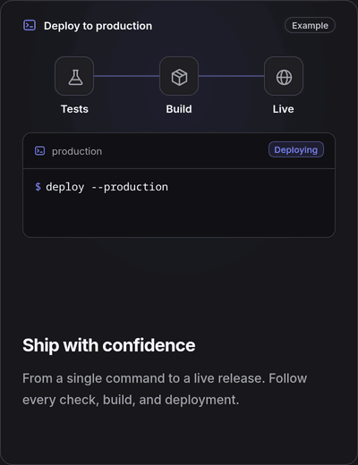
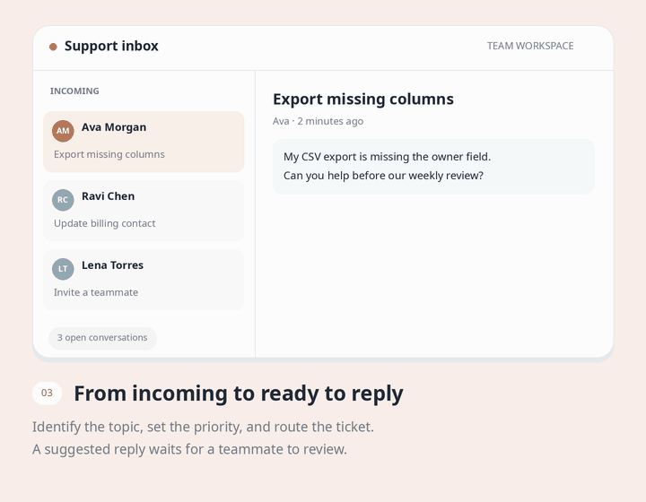
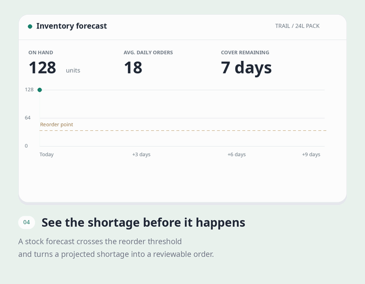

# Animated Feature Cards

A coding-agent skill for building small, looping product demos inside feature cards. Show a search finding an answer, a deployment going live, or a forecast becoming an action, within a compact piece of UI.

The skill helps an agent choose a scene, write its storyboard, and implement it using your project's framework and design system. It covers pacing, staged responses, quiet resets, reduced motion, and responsive layouts.

## Examples

Four original HTML/CSS/SVG examples with fictional data. These are narrow, 400-pixel cards with locally bundled Inter, readable demo elements, and bright blue, indigo, pink, and emerald accents. Each 12-second loop holds its result for several seconds, then briefly fades to reset.

**[Open the live gallery](examples/index.html)** locally in your browser to play, pause, or scrub the scenes. No build step or server is needed. The GIFs below are captured from the same source; they are documentation assets, not components you install in your app.

Prefer still images? [View all four static previews](assets/examples/README.md). GIF playback depends on your Markdown viewer and cannot automatically honor reduced-motion preferences.

### 1. Workspace search · Blue



One question, a custom SVG document stack, and one clearly readable answer. A scan travels down the documents before the search gives way to a date and its source citation.

| Beat | What changes |
| --- | --- |
| Establish | “When do we launch?” and the connected source documents are visible. |
| Search | A blue scan moves across the document artwork. |
| Answer | A source-backed answer appears: Friday, Oct 23, at 10:00 AM. |
| Rest | The answer and verified citation stay visible before the reset. |

**Useful for:** knowledge search, research assistants, support copilots, and connected chat. Show one concise answer instead of a full conversation squeezed into a card.

### 2. Release pipeline · Indigo



Three large pipeline nodes explain the journey from a command to a live release. Signals travel along the SVG connectors, terminal checks resolve underneath, and a solid indigo receipt shows the deployed URL.

| Beat | What changes |
| --- | --- |
| Establish | Tests, Build, and Live sit above a deployment command. |
| Test | The first node completes and “Tests passed” appears. |
| Build | The second node completes and the build version appears. |
| Deploy | Live completes, the status becomes Ready, and the URL appears. |
| Rest | The completed pipeline holds before resetting. |

**Useful for:** deployment platforms, publishing workflows, approval pipelines, and automation. Keep the steps large and synchronize each node with the result below it.

### 3. Support routing · Pink



A single customer request provides the context. Classification and priority appear on the request, a signal follows the routing connector, and the assignment and reply draft arrive underneath.

| Beat | What changes |
| --- | --- |
| Establish | Ava's request explains the export problem. |
| Classify | Exports and High priority tags appear. |
| Route | A routing signal travels to the assignment card. |
| Prepare | Maya receives the request and a reply draft becomes ready for review. |
| Rest | The full handoff holds before resetting. |

**Useful for:** shared inboxes, operations queues, document classification, and issue routing. Give the conversation enough space to read, and make the human review step explicit.

### 4. Demand forecast · Emerald



A full-width SVG chart gives the forecast room to breathe. Available stock and daily demand establish the context, the dashed line projects the shortage, and a bold reorder recommendation turns the signal into an action.

| Beat | What changes |
| --- | --- |
| Establish | The product, 180 units of stock, and demand of 36 units per day are visible. |
| Project | The dashed forecast extends from today toward zero stock on Oct 20. |
| Flag | The projected stockout point appears. |
| Act | A 240-unit reorder recommendation and a four-day lead time appear. |
| Rest | The chart and recommendation hold together before resetting. |

**Useful for:** inventory planning, capacity monitoring, spending forecasts, and usage limits. Keep chart labels readable and reveal the suggested action after the signal that explains it.

## Use the skill

Give your coding agent [SKILL.md](SKILL.md) and keep [references/pattern-catalog.md](references/pattern-catalog.md) beside it. If your agent supports installed skills, place this repository's contents in a skill directory named `animated-feature-cards` using that agent's normal installation process.

You can also point an agent directly at the instructions:

> Read `SKILL.md` and use its pattern catalog to build four animated feature cards for our landing page. Inspect the existing components and styling first. Build rich, detailed miniature product UIs using SVG liberally alongside HTML for custom artwork, charts, connectors, diagrams, and masks. Keep cards around 360–420 pixels wide, and design the inner elements at that size instead of shrinking a full dashboard. Use readable text, clear hierarchy, confident font weights, and bright blue, indigo, pink, or emerald accents within our design system. Use realistic fictional data, give each card a different motion pattern, and hold the result long enough to read. Apply the `emil-design-eng` skill if available. Implement responsive layouts, useful reduced-motion states, and clean up any timers or observers.

For a specific scene:

> Build a deployment card with three large SVG pipeline nodes and a miniature terminal. Show a command, two checks completing, and a deployment URL appearing. Hold the success state, then fade back to the beginning. Use Inter and match our existing colors. Keep the card's outer size stable throughout the loop, with the main labels readable at its actual display size.

Helpful inputs are the feature name, its action and result, the target page or component, and design or motion constraints. If you only have feature copy, the skill asks the agent to invent a suitable storyboard.

## What the skill covers

The [pattern catalog](references/pattern-catalog.md) includes streaming lists, terminal sequences, cursor interactions, connection handshakes, integration states, chat and tool calls, event stacks, filtering, progress rings, maps, counters, and hover-led scenes.

Each card follows a short sequence:

```text
Establish → Action → Response → Result → Dwell → Reset
```

Keep detail in the composition. Use HTML for text, lists, and controls, then SVG for custom geometry: documents, networks, charts, or product artwork. Most supporting detail can remain still while one focal action tells the story. Readability at the real card width matters more than fitting an entire application into the scene.

## Motion and implementation

| Element | Starting range |
| --- | --- |
| Small state transition | 180–280 ms |
| Row or card movement | 300–600 ms |
| Cursor travel | 500–1,000 ms |
| Final result hold | 1.2–2.5 seconds, longer for detailed content |
| Complete loop | 7–16 seconds |

Keep the outer card stable and clip motion inside its demo area. Favor transforms and opacity, deterministic data, and explicit scene states. Reuse the application's components, tokens, icons, and installed animation tools.

For shipped interfaces, provide a meaningful static state under reduced motion, preserve real hover and keyboard behavior, and clean up timers and observers. Pause offscreen work where appropriate. Check narrow layouts, text clipping, and the loop boundary as carefully as the main action.

## Repository contents

| Path | Purpose |
| --- | --- |
| [SKILL.md](SKILL.md) | Main agent instructions and quality checklist |
| [references/pattern-catalog.md](references/pattern-catalog.md) | Storyboards for 12 patterns |
| [agents/openai.yaml](agents/openai.yaml) | Agent-facing display metadata |
| [assets/examples/](assets/examples/) | Four animated GIFs and matching static PNGs |
| [examples/index.html](examples/index.html) | Live gallery with pause and timeline controls |
| [examples/examples.js](examples/examples.js) | Original HTML/SVG scenes and native animation timelines |
| [examples/examples.css](examples/examples.css) | Colors, typography, and responsive styling |
| [examples/fonts/](examples/fonts/) | Inter variable font and its license |
| [scripts/capture_examples.mjs](scripts/capture_examples.mjs) | Browser capture at exact timeline positions |
| [scripts/render_examples.py](scripts/render_examples.py) | Downsampling and shared-palette GIF encoding |

## Regenerate the illustrations

The renderer captures the HTML/SVG scenes in Chromium at twice the output resolution, then uses Pillow to downsample and encode the GIFs. Rendering is local. The live gallery has no JavaScript dependencies and uses the bundled Inter font.

Install the capture dependencies in a temporary directory. Python with Pillow must also be available:

```sh
npm install --prefix /tmp/animated-feature-render playwright
/tmp/animated-feature-render/node_modules/.bin/playwright install chromium
export EXAMPLE_PLAYWRIGHT_MODULE=/tmp/animated-feature-render/node_modules/playwright
```

From the repository root:

```sh
python scripts/render_examples.py
# Optional: regenerate one scene or only the PNG previews.
python scripts/render_examples.py --scene release-pipeline
python scripts/render_examples.py --stills
```

If you already have a compatible Chromium installation, set `EXAMPLE_CHROMIUM_PATH` to its executable.

Each GIF is 400 × 520, lasts 12 seconds, loops indefinitely, and uses a shared palette to keep colors stable. The PNGs show completed scenes. The gallery honors reduced motion with finished states, pauses hidden/offscreen work, and supports manual timeline inspection. GIF playback cannot provide those runtime behaviors. Adapt website cards to the host application's UI stack.
