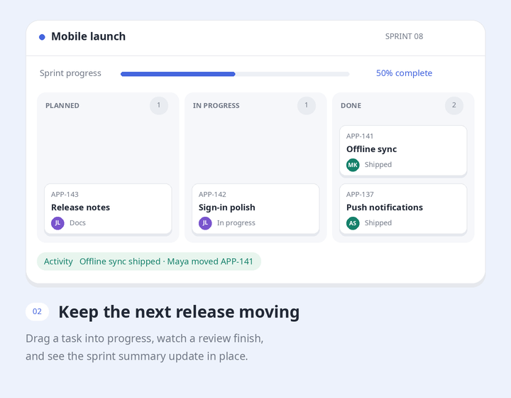

# Static examples

Completed states of the four animated scenes. These images do not animate.

## Workspace assistant

## Sprint board

## Support triage

## Inventory forecast

[Back to the skill README](../../README.md)
